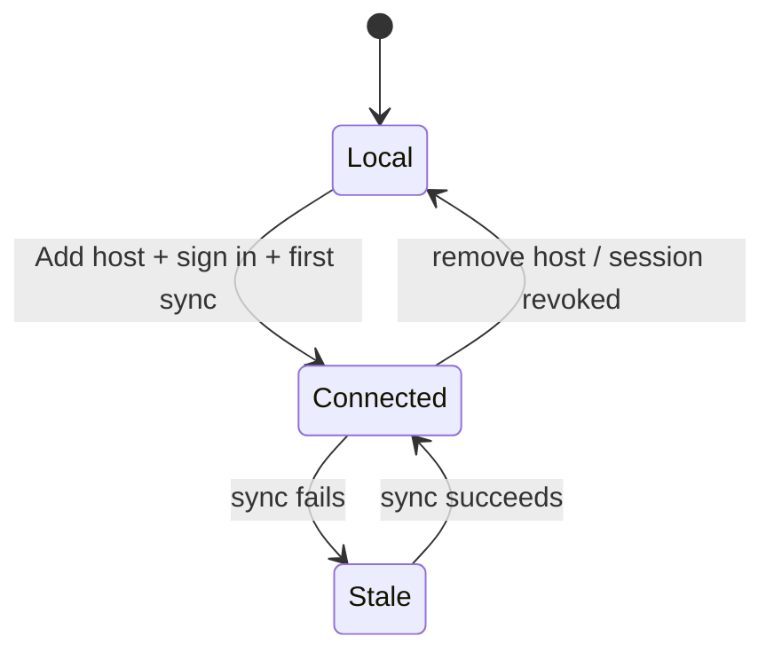

# E01 — Connected mode

Decided by the owner on 2026-10-16 (`docs/canonico.md` §22):

- connected mode exists, and the host address is configurable at runtime;
- the host runs as a compose on the owner's Coolify, built with **Bun + Elysia**;
- people get in with an **admin-issued short access code**, then set their own password;
- that password signs in to the host and opens a **private local vault the host can't read**;
- people can add personal tools and favorite org tools;
- **Elysia 2** (beta) from the start, on purpose, to find bugs;
- **biometrics gate everything** locally;
- **one host = one guild**: each container serves one organization;
- credential sharing between people continues in `docs/epics/E02-credential-sharing.md`;
- email sending and the Carna services are deferred.

Everything else here is a proposal waiting for the owner's reading (`AGENTS.md`). Approved items
move to `docs/canonico.md` (§14, §22); until then this file is their only home.

Evidence: `leitura` of repo docs, repo code and the vendor docs linked inline, unless marked
otherwise. The only execution is the owner's Jitsi test (§9).

## 1. Intent

Owner, 2026-10-16:

> quero hospedar um compose do servidor no meu coolify, quero que o bond tenha uma opcao de
> adicionar host, ao adicionar host vc pode logar naquele host e ver as ferramentas que ja tem la.
> quando eu for botar o host no ar, quero poder configurar os acessos dos usuários ao host para que
> possam entrar (com acessos ou email+código de acesso) e quero sincronizar as alterações nas
> ferramentas, as permissoes as ferramentas e tudo mais assim. um usuário pode adicionar suas
> proprias ferramentas para facilitar seu acesso a seu trabalho, favoritar ferramentas da org ou
> como preferir.

Product reading (`CONTEXT.md`): the server is the **host**; users are **people**; permissions are
**roles** and **grants**. The Nod is the edge that groups self-hosted open-source tools on one
screen — not a Teams clone.

## 2. The flow

```mermaid
sequenceDiagram
    participant O as Owner (admin)
    participant C as Coolify
    participant H as Host
    participant B as Nod (person)
    O->>C: deploy compose (host + volume)
    C->>H: first boot: empty DB, signing key; operator runs setup-code in the container terminal
    O->>B: Settings → Hosts → Add host (address)
    B->>H: GET /.well-known/nod (key fingerprint)
    O->>B: confirm fingerprint, sign in with setup code, set password
    H-->>B: owner becomes host admin; token → keychain
    O->>B: publish local tools as org tools (empty host only)
    O->>B: create people (email, roles) → short access code shown once
    Note over O,B: owner hands the code over (chat, in person)
    B->>H: person: Add host → email + access code → set password → first sync
    H-->>B: signed snapshot: org tools visible to my roles + my personal tools + my favorites
    O->>B: admin adds Jitsi, grants role "team"
    B->>H: every connected Nod: next sync
    H-->>B: Jitsi appears for people with "team"
```

## 3. Outcome

Done when observed on the real surface:

1. A Nod with no host behaves exactly as today (RF-01…RF-29).
2. The host comes up from one compose on Coolify, with its data on a volume that survives redeploys.
3. Settings → Hosts → Add host, sign in, and the org tools granted to the person's roles appear.
4. The admin creates a person and hands over a short access code; the person redeems it, sets a
   password, and from then on signs in with email + password. The host never holds the password.
5. The admin adds a tool, edits a grant or revokes a person; every connected Nod reflects it at its
   next sync, with no new release.
6. A person adds a personal tool on one machine and sees it on another machine signed in to the same
   host; nobody else sees it.
7. A person favorites org tools; the favorites follow them across machines.
8. A connected Nod without network unlocks and shows the cached tools with the last-sync time.

## 4. Non-goals

- Chat, presence, calls, files, notifications, realtime: the tools do that (`docs/canonico.md` §17).
- Proxying or hosting tool content; iframe tabs stay deferred (`docs/canonico.md` §2).
- Syncing the vault: each machine keeps its own (`docs/canonico.md` §17). Moving a credential to
  another person is an end-to-end share (`docs/epics/E02-credential-sharing.md`), not sync.
- SSO into the tools in this epic's first phases (§13, M4 keeps it as a later milestone).
- Several guilds at once: one host serves one guild, and one Nod is in **one guild at a time**
  (owner, 2026-10-16: "no momento nao. se sair e voltar ele poderia entrar em outra"). Removing the
  host (§5) and adding another is how a person changes guild.

## 5. Modes



| | Local | Connected (Stale = same, from cache) |
| --- | --- | --- |
| Org tools, roles, grants | local SQLite (seed on first boot) | host, signed snapshot; admin edits go to the host |
| Personal tools, favorites | local | host, per person; written through an outbox |
| Unlock | local password / biometrics | same, works offline |
| Host session | — | bearer token in the keychain |
| Events | local | pushed in batches |
| Vault | keychain | keychain, unchanged |

**Local → Connected.** Every local tool is offered as a **personal tool** on the host — nothing is
lost and nothing leaks to others. Only the first admin of an **empty** host may instead publish them
as org tools, once (bootstrap).

**Connected → Local** (remove host): personal tools and favorites stay as local tools; org tools
are removed (question 4).

## 6. What lives where

| Fact | Owner | Nod holds |
| --- | --- | --- |
| People, sign-in methods, host sessions | host | own token in keychain |
| Roles, person ↔ role | host | cache |
| Org tools (entries, views, icons, order) | host, admin-edited | cache |
| Grants (role ↔ org tool) | host, admin-edited | cache |
| Personal tools | host, owned by one person | cache + outbox |
| Personal views (a saved address under any tool the person sees — `docs/epics/E03-docked-tabs.md` §5) | host, owned by one person | cache + outbox |
| Favorites (person ↔ tool, order) | host, per person | cache + outbox |
| Events | host after ack | queue until ack |
| Tool credentials | keychain of each machine | — |
| Tool sessions (cookies) | app webview profile (`docs/tinyjs.md` §3) | — |

Entry shape: today's `Entry` (`shared/types.ts`) gains `scope: 'org' | 'personal'` and, for
personal, `ownerId`. A `View` gains the same `scope`/`ownerId`, so a person can hang their own views
under an org tool. Grants apply only to org tools. Personal tools and views are visible only to
their owner; the host API never returns them to anyone else, admin included. They are not
end-to-end encrypted: whoever operates the host database can read them (accepted, or question 5).

Sidebar order (proposal): favorites first in the person's order, then the rest of the org tools,
then personal tools. `⌘1`…`⌘9` follow that order.

## 7. Signing in to the host

- **Admin bootstrap.** While the database has no admin, the operator runs `bun run setup-code` in
  the container (Coolify's terminal), which prints a one-time setup code to that terminal only.
  Nothing secret goes to the container log (`AGENTS.md`: no secret in logs). Whoever redeems the
  code, through the same activation as anyone else, becomes the first admin; the code then dies.
  Same idea as "first account is admin" (`docs/canonico.md` §9), safe for a public address. Exact
  contract: `docs/specs/SP02-auth-and-keys.md` §3.
- **Access code.** The admin creates a person (email, name, roles); the host shows a short access
  code **once**.
  - Format: 8 characters of Crockford base32, shown `XXXX-XXXX` (40 bits).
  - Single use, valid 72 h, stored hashed, bound to that email.
  - 5 wrong tries kill it; reissuing one kills the previous one.
  - The admin hands it over by any channel. No email (owner, 2026-10-16).
- **Activation.** Nod → Add host → email + access code → the person sets a password, minimum 8
  characters, the same rule as `validateNewPassword` in `shared/auth.ts` → session.
- **Sign-in after that**: email + password.
- **Reset**: the admin reissues an access code; the person activates again with a new password
  (consequence for the vault below).
- **Errors** are one message for every failure; rate limit per identity and IP — both reused from
  the Carna pattern (`docs/downscale-carna.md`, "O que o Nod herda").
- **Session**: random bearer token, stored hashed, 14 days, one row per device, revocable by the
  person and the admin (keeps RF-17's "revoga a linha no host").

### One password, two keys: the host never sees the password

Owner, 2026-10-16: the password signs in **and** opens a private local vault that the server
can't access. If the Nod sent the password to the host, whoever runs the host could log it and
open the vault. So the Nod derives two keys and sends only one of them, the scheme Bitwarden-style
managers use:

```text
master   = PBKDF2-HMAC-SHA256(password, salt, 600 000)   salt: 16 random bytes per person, kept by the host
authKey  = HMAC-SHA256(master, "bond/auth/v1")            → sent to the host on activation and sign-in
vaultKey = HMAC-SHA256(master, "bond/vault/v1")           → never leaves the machine
```

- The host stores `argon2id(authKey)` (`Bun.password`). It can't compute `vaultKey` from
  `authKey`. Its only path to the vault is guessing the password offline, paying PBKDF2 for every
  guess.
- Sign-in is two calls:
  1. `POST /v1/auth/salt {email}` → salt. An unknown email gets a fake salt that stays the same for
     that email, `HMAC(hostSecret, email)`, so the reply doesn't reveal who exists.
  2. The Nod derives the keys and sends `POST /v1/auth/login {email, authKey}`.
- PBKDF2, HMAC and AES-GCM are native in the Nod runtime (`docs/tinyjs.md` §5). The iteration
  count is the same as the local password's (`PBKDF2_ITERATIONS` in `shared/auth.ts`). Its cost is
  still to be measured (`docs/canonico.md` §23 q6).
- **One password per person.** In connected mode the local password **is** the host password. The
  Nod keeps its local verifier (`docs/canonico.md` §9), so unlocking works offline.
- **Changing the password** (online, from Nod Settings):
  - the Nod sends the old `authKey` and the new one;
  - it re-encrypts the local vault with the new `vaultKey`.

  Credentials survive (RF-24).
- **Reset** through a new access code: the old `vaultKey` is gone, so that machine's vault is
  **wiped** and the person enters their logins again. This is also what stops an admin who issues
  a fresh code from opening someone's vault.

**The vault itself** stays on the machine and never syncs (§4). Each credential value is
encrypted with `vaultKey` (AES-256-GCM, a nonce per write) before it goes into the keychain under
`nod.cred.<person>.<tool>` (`docs/canonico.md` §11). What changes from today:

- **Fixed:** another process of the same OS user that reads the keychain item gets ciphertext. This
  closes the limit accepted in `docs/canonico.md` §11.
- **Biometric unlock** needs `vaultKey` without the password, so with biometrics on, `vaultKey`
  itself sits in the keychain. On that machine, protection against other processes of the same OS
  user goes back to today's level. **Decided by the owner on 2026-10-16**: biometrics on, gating
  unlock and every reveal, copy and share (`docs/epics/E02-credential-sharing.md` §5).
- **Local mode** uses the same derivation with a local salt, so the vault works the same with or
  without a host.

### Deferred: email sign-in

Owner, 2026-10-16: "vamos desconsiderar o sistema de email agora". Kept as the design for when mail
returns; nothing below is in M1.

A plain magic link (`click → you're in`) is built for browsers: the link opens in whatever browser
or phone the email is read on, and that browser isn't the Nod. So the link **approves a sign-in
the Nod started**, and the Nod collects the result itself:

```mermaid
sequenceDiagram
    participant B as Nod backend
    participant H as Host
    participant M as Mail (SMTP)
    participant P as Person (any browser, any device)
    B->>H: POST /v1/auth/email {email, deviceName, verifierHash}
    H-->>B: {requestId, matchCode "47"}  (same reply whether or not the email exists)
    H->>M: email: link https://host/a/<token> + code 123456 + "Nod shows 47"
    Note over B: shows "check your email — 47"; polls every 2 s (backend timer)
    alt person clicks the link
        P->>H: GET /a/<token> → page "Sign in Nod on <deviceName>? Nod shows 47" [Approve]
        P->>H: POST /a/<token> (approve)
    else person types the code in Nod
        B->>H: POST /v1/auth/email/code {requestId, code}
    end
    B->>H: POST /v1/auth/email/poll {requestId, verifier}
    H-->>B: session token (once) → keychain
```

Rules:

- **The click needs a button**, not just a GET. Mail scanners (corporate link checkers) fetch links
  before the person does, and a link that signs in on GET would be used up, or approved, by the
  scanner.
- **Only the Nod that started the request gets the token.** It holds a random `verifier` and sent
  only its hash. A forwarded or leaked link approves a request whose token nobody else can collect.
- **The match code** ("Nod shows 47") is on both the approval page and the Nod. A person who
  receives an email they didn't ask for sees a request that doesn't match their screen.
- **The link works from the phone.** Approving on the phone signs in the Nod on the computer.
- **Limits**:
  - TTL of 15 minutes, single use;
  - token and code stored hashed;
  - per email: 5 code attempts and 3 emails every 15 minutes;
  - per IP: rate limited;
  - the same reply whether or not the email exists.
- **Optional shortcut**: after approving, the page can offer `nod://signed-in` to bring the Nod
  to the front (`urlScheme`, single instance — `docs/tinyjs.md` §8). Polling already finished the
  sign-in, so the shortcut is cosmetic.

### Deferred: sending email through the existing mail server

Observed by execution, 2026-10-16 (public DNS and an SMTP greeting only; no login, no mail sent):

- the domain has an MX that points at the team's mail server.
- SPF authorizes that server and Amazon SES; mail leaving it passes SPF.
- DMARC `p=quarantine`: mail that doesn't align goes to spam, so the host must send *through* this
  server or SES, never directly from the VPS.
- The server is **Haraka**, with submission on **465 (TLS)** and **587 (STARTTLS)**, both offering
  `AUTH PLAIN LOGIN`. Port 25 didn't answer from this network.
- DKIM: not checked (selector unknown).

So yes: the host sends through the owner's SMTP. It needs a sending account on that server (e.g. a
no-reply mailbox) and four env values: host, port, user, password. Check before M1: send one test
email to an outside mailbox and read `Authentication-Results` for `spf=pass dkim=pass dmarc=pass`.

SMTP client per stack:

- **Bun** has no SMTP client built in. Use `nodemailer` (one dependency), or a small hand-written
  client over `Bun.connect` with TLS.
- **Phoenix**: Swoosh with its SMTP adapter.
- **PocketBase**: SMTP built in.
- **An HTTP mail API** (SES is already in the SPF) is a `fetch` call from any stack.

## 8. Sync contract

- `GET /.well-known/nod` → API version, host public key (Ed25519) + fingerprint, minimum app
  version, available sign-in methods.
- `GET /v1/state` (`If-None-Match`) → one **signed full snapshot**
  `{ version, issuedAt, keyId, me, roles, orgTools, personalTools, favorites }`, filtered to the
  person. Full snapshot, not deltas: small, and "host wins" stays trivial.
- **Writes**:
  - admin: org tools, roles, grants, people — direct API calls from Nod Settings; online only.
  - person: personal tools, favorites — through a local **outbox** replayed in order; one writer
    (the person) per record, so last-write-wins by `updatedAt` is enough.
- `POST /v1/events` — batches with client ids; idempotent; the host acks the highest id.
- **When**: on unlock, every N minutes while unlocked (backend timer — `docs/tinyjs.md` §3), and
  "Sync now".
- **Trust**: the host key is pinned at Add host (fingerprint shown to confirm, or carried by an
  invite link `nod://join?host=…&code=…&fp=…`); every snapshot must verify against it; a key change
  is an explicit re-add, never silent. Ed25519 is native in the Nod runtime (`docs/tinyjs.md` §5).
- **Vault binding**: each vault item stores the origin it was saved for; the login adapter never
  fills when the tool's origin differs. With the host able to change any tool URL, this is what
  keeps a swapped URL from receiving a credential.

## 9. Build-time limits of a host-added tool

A tool added on the host appears for everyone with no release. Two things still come from
`tinyjs.json` at build time:

- **`login.report`**: only origins in the release's gate can report the login result
  (`docs/canonico.md` §8). A host-added tool opens and the cascade still fills the form; it just
  doesn't report back until a release lists it.
- **Camera / mic**: only origins in the release's gate skip the system prompt (`docs/canonico.md`
  §8). A host-added org tool still gets camera and mic, but behind the system prompt (macOS,
  Windows) and denied on Linux until a release lists it; the Nod must not label it as "outside
  the org". Details: `docs/tinyjs.md` §6.

Both gaps are a delay, not a permanent limit (owner, 2026-10-16): once the host and the `release-*`
pipeline with auto-update (RF-55, `docs/distribuicao.md` §8) work, the next release closes them.
Proposed: the release build takes the gate origins from the host's org tools — the signed
snapshot, verified against the pinned key — besides the seed, so a tool added on the host reaches
every Nod's gate at the next `release-*` without editing the seed by hand.

## 10. Deployment on Coolify

One compose, one service, one volume:

| Piece | Choice |
| --- | --- |
| Service | `host`, single replica — SQLite has one writer |
| Data | volume at `/data`: `host.db` (WAL), signing key generated on first boot |
| Config (env) | public URL; token TTL. (SMTP settings come back with email sign-in, deferred.) |
| TLS | Coolify's proxy; the host speaks plain HTTP inside the network |
| Health | `GET /health` |
| Backup | SQLite `VACUUM INTO` snapshot on a schedule into `/data/backups`, copied off the box (target: question 7) |

The host and its addresses are not named here (`AGENTS.md`: no invented addresses).

## 11. Stack

The owner's ask: very simple, without pulling code from elsewhere. Same host scope for every option
(§6–§8).

| | **Bun, no framework** | **Bun + Elysia** | **Elixir: Phoenix + SQLite** | **Go: PocketBase** |
| --- | --- | --- | --- | --- |
| HTTP | `Bun.serve` with `routes` (`https://bun.com/docs/runtime/http/routing`) | Elysia 1.4.30 stable; **2.0 is still beta** (`next` = `2.0.0-beta.32` on npm, checked 2026-10-16) | Phoenix 1.8.15 | built in |
| SQLite | `bun:sqlite`, built in, synchronous (`https://bun.com/docs/runtime/sqlite`) | same | `ecto_sqlite3` 0.25.0 | built in |
| Password hash | `Bun.password` (argon2id), built in (`https://bun.com/docs/runtime/hashing`) | same | generated by `phx.gen.auth` | built in |
| Email code / magic link | ours: ~a page of code | ours | `phx.gen.auth` in 1.8 generates magic-link login into your app (`https://hexdocs.pm/phoenix/changelog.html`) | OTP built in (`https://pocketbase.io/docs/authentication/`) |
| Sending mail | dependency or hand-written SMTP, or `fetch` to an HTTP mail API | same | Swoosh (comes with Phoenix) | SMTP built in |
| Admin UI | Nod Settings | Nod Settings | Nod Settings (or LiveView) | its dashboard for free, or Nod Settings |
| Session revocation | our token rows | ours | generated token table | **stateless JWT, no logout endpoint**; revoke by changing password or collection secret (same doc) |
| Shares code with the Nod | **yes**: `shared/types.ts` and `shared/catalog.ts` import only types (`leitura` of their imports) and already run under `bun test` | yes | no: second language, contract by JSON | no: rules in collections, hooks in Go or JS |
| Stability | Bun stable | 1.x stable, 2.x beta | stable | "full backward compatibility is not guaranteed before reaching v1.0.0" (PocketBase README) |
| Carna reuse | patterns only | patterns only | invite, token, rate limit code (`docs/canonico.md` §18) | none |
| Dev loop | `bun --watch` | same | `mix phx.server` reload | `air` |
| Memory idle → under load (RSS, measured) | 24 → 39 MiB | 37 → 48 MiB | 192 → 217 MiB | 44 → 100 MiB |
| Image | 347 MB (`oven/bun`, not slimmed) | 347 MB | 267 MB (release on `debian:trixie-slim`) | 56 MB (`alpine` + binary) |

**Memory measurement** (execution, 2026-10-16, throwaway probes, deleted afterwards):

- Each probe implements the same three routes on SQLite:
  - `GET /v1/state`, returning 200 entries;
  - `POST /v1/events`, a 20-event batch in one transaction;
  - `GET /health`.
- Load: 20 000 requests (1 in 4 a write) at concurrency 50.
- Setup: Docker on macOS (Linux arm64 VM), each container pinned to 2 CPUs with a 1 GB limit, which is close to a small VPS.
- RSS is summed from `/proc/*/status` inside the container.
- Versions: Bun 1.4.3, Elysia 1.4.30, Phoenix 1.8.15 `mix release` on OTP 29 with defaults, PocketBase v0.40.5 with JS hooks.
- What the memory is:
  - On BEAM, `:erlang.memory()` reported 90 MB, of which 32 MB is loaded code. The rest of the RSS is allocator carriers. Tuning could lower it; it wasn't tuned.
  - PocketBase grows under load through its pool of JS hook VMs; Go-only hooks weren't measured.
- Throughput isn't comparable, because Docker's port forwarding on macOS limits it. No probe had auth or snapshot signing.

**Splitting data access and rules into two services** (owner's idea: Phoenix or Elysia over SQLite
for data, TypeScript for business rules).

Proposal: don't split into processes. The rules of this host are mostly *about which rows a person
may see or write*:

- grants apply only to org tools;
- personal tools are returned only to their owner;
- an admin edit and its event commit together.

Across two services each of these becomes an internal API call, and "check, then write" loses its
transaction. SQLite has one writer, so only one process should own the file. Costs of the split:

- two deploys;
- an internal contract to keep in sync;
- with Phoenix as the data side, ~190 MiB idle for a part that `bun:sqlite` does in-process.

The TypeScript sharing works without a second service. It's a module boundary inside one Bun
process, the same layout the Nod already uses:

- `shared/`: pure rules and types, tested by `bun test`, imported by both Nod and host;
- `host/repo.ts`: the only module touching SQLite, like `backend/repo.ts`;
- `host/http.ts`: routes that call rules and repo.

A second process earns its place only for something the host doesn't do today: realtime fan-out,
long background jobs, or SSO (M4). Phoenix fits there later, as its own service with its own data.

**Growing toward the Carna** — deferred by the owner on 2026-10-16 ("deixar isso como algo futuro").
When it returns: Carna pieces enter as separate services beside the host, each with its own data,
trusting the host's session (`GET /v1/me`, or OIDC at M4). What M1 keeps so this stays open: the
host owns identity and exposes it by API, and the APIs are versioned (`/v1`), never shared
database access.

**Decided by the owner on 2026-10-16: Bun + Elysia**, one process, in this repo under `host/`.

- **Elysia 2.0 beta** from the start — decided by the owner on 2026-10-16: "usar logo a v2 pra
  testar impactos e encontrar bugs". On 2026-10-16 npm's `next` tag is `2.0.0-beta.32` (stable
  line: 1.4.30). Pin the exact beta in `bun.lock` and bump on purpose, one beta at a time. Each
  bump runs the host tests, and a regression found goes upstream as an issue.
- **Elysia's role**: routes, request/response schemas (`t.*`), and a typed client usable from the
  Nod backend (Eden, `[INFERENCE]` from Elysia's docs, not checked in the tinyjs runtime).
- **Layout**:
  - `shared/`: pure rules and types, used by both sides;
  - `host/repo.ts`: the only module touching `bun:sqlite`;
  - `host/app.ts`: the Elysia routes.
- **Dependencies**: Elysia only. Mail is deferred, and SQLite and argon2id come with Bun.

## 12. Threats

| Threat | Defense |
| --- | --- |
| Host admin or compromised host points a tool at an attacker origin | Vault items bound to origin (§8); signed snapshot with pinned key. |
| A different server answers at the same address later | Pinned key; mismatch refuses sync until an explicit re-add. |
| Access-code guessing | 40-bit code, single use, 72 h TTL, hashed, bound to one email, dead after 5 wrong tries; IP rate limit; one error message. |
| Host operator reading vaults | The password never reaches the host; only `authKey` does, and `vaultKey` can't be derived from it (§7). Offline guessing costs PBKDF2 + argon2id per try. |
| Admin reissues a code to get into someone's Nod | Reset wipes that machine's vault; the old one can't be opened with the new password. |
| Setup code stolen from the operator's terminal | Single use, 24 h TTL, only while no admin exists; running the command again replaces it. |
| Stolen host token | Keychain only, behind local unlock; per-device rows revocable by person and admin. |
| Personal tools read by others | API filters by owner; host DB operator can read (not E2E). |
| Secrets in debug traces | Host token never crosses page↔backend RPC (`AGENTS.md` lists what `TINYJS_DEBUG=1` prints). |
| Host down | Cache; tools need their own network anyway (`docs/tinyjs.md` §10.4). |

## 13. Milestones

Stories, points and effort blocks: `docs/epics/blocks.md`.

| Milestone | Scope | Proof |
| --- | --- | --- |
| **M0 — decide** | Nothing pending for M1: stack, sign-in, biometrics, tenancy decided (`docs/canonico.md` §22) | — |
| **M1 — host** | Compose; schema (people with salt and `argon2id(authKey)`, sessions, access codes, roles, person_role, entries with scope/owner, views, grants, favorites, events, meta); setup code; access-code activation; salt + login; admin API; `/v1/state` signed; personal + favorites API; events ingest; backup job | Deployed on Coolify; snapshot verifies with the published key; duplicate event batch is a no-op; restart keeps data; the host DB holds no password and no `vaultKey` |
| **M2 — Nod connected** | Settings → Hosts (add, sign in, status, last sync, sync now, remove); cache; outbox; admin screens against the host; personal tools; favorites; sidebar order; local-tools migration; origin-bound vault | Outcomes 1, 3–8 on two machines |
| **M3 — operations** | Sessions per device with revoke; minimum app version; auto-update manifest served from the host (`docs/canonico.md` §19, F5) | Revoked device stops syncing; old app is told to update |
| **M4 — later: SSO into tools** | Tools sign in through one identity provider so opening a tool needs no form: either the host becomes an OIDC provider, or a ready one (Pocket ID `https://github.com/pocket-id/pocket-id`, Authelia `https://www.authelia.com/integration/openid-connect/introduction`) syncs people and roles from the host. Needs the passkey/OIDC-in-webview spike (`docs/canonico.md` §23 q3) and the per-tool OIDC inventory (§23 q1) | Separate epic when M2 lands |

## 14. Proposed requirements

These requirements entered `docs/canonico.md` §14 on 2026-10-16 (RF-30 to RF-43); they replace RF-17 and RF-18. The table stays here for reference.

| ID | Requirement | Acceptance |
| --- | --- | --- |
| RF-30 | Without a host, the Nod makes no call to any host. | Network capture of a local session shows only tool traffic. |
| RF-31 | Add host pins the host key; later snapshots must verify against it. | Wrong `fp` aborts with one error, nothing stored; a host answering with another key is refused until re-added. |
| RF-32 | The host boots empty with a one-time setup code that creates the first admin. | Code works once; second use fails with the single error. |
| RF-33 | The admin creates a person and gets a short access code shown once; the person redeems it in the Nod and sets a password; later sign-ins use email + password. | Code works once and dies after 5 wrong tries or 72 h; wrong code or password returns one message. |
| RF-34 | Org tools, roles and grants come from the host; admin changes reach every connected Nod at next sync, no release. | Admin adds Jitsi granted to "team"; after "Sync now" only people with "team" see it. |
| RF-35 | A person adds personal tools, visible only to them, on every machine signed in to the host. | Personal tool added on machine A appears on machine B after sync; another person and the admin don't see it. |
| RF-36 | A person favorites org tools; favorites and their order follow the person. | Favorite on A shows first in the sidebar on B. |
| RF-37 | Connected Nod works offline from cache; personal edits made offline sync later. | Network off: unlock, sidebar, Home work; add a personal tool; network on: it reaches the host. |
| RF-38 | The vault never fills a login on an origin other than the one the credential was saved for. | Admin changes a tool URL; form fill stops for it. |
| RF-39 | Revoking a person or a device on the host ends that session. | Next sync fails with "signed out"; the cache is cleared of org tools. |
| RF-40 | Adding a host offers local tools as personal tools; an empty host's first admin may publish them as org tools. | After Add host, no local tool disappears. |
| RF-41 | The host runs as one compose with data on a volume and a scheduled backup. | Redeploy keeps data; a backup restores into a fresh host. |
| RF-42 | The password never leaves the machine: the host receives only `authKey`. | A capture of activation, sign-in and password change shows no password; the host DB has only `argon2id(authKey)` and the salt. |
| RF-43 | Vault values in the keychain are encrypted with `vaultKey`; a password reset by access code wipes that machine's vault. | Reading `nod.cred.*` with the system keychain tool shows ciphertext; after a reset, the old credentials are gone and the Nod asks for them again. |

## 15. Open questions for the owner

1. ~~Elysia version~~ — decided 2026-10-16: 2.0 beta, pinned.
2. ~~Biometrics~~ — decided 2026-10-16: on, for everything.
3. ~~Mail~~ — deferred 2026-10-16.
4. Removing a host: keep personal tools and favorites as local tools (proposal), or wipe.
5. Personal tools readable by whoever operates the host DB: acceptable?
6. ~~Several guilds~~ — decided 2026-10-16: one guild at a time per install.
7. ~~Backup target off the VPS~~ — decided 2026-10-16: a local volume only for now; the off-VPS copy is deferred.
8. ~~Offline: how long a stale cache keeps showing org tools~~ — decided 2026-10-16: 14 days after the last successful sync, then the org tools hide until a sync succeeds.
9. ~~Host address: named by the owner (`AGENTS.md`)~~ — decided 2026-10-16: configurable at deploy through an env var; no address in the code.

## 16. Vocabulary to propose

New terms wait for the owner before entering `CONTEXT.md`: **local mode**, **connected mode**,
**org tool**, **personal tool**, **favorite**, **access code**, **setup code**, **snapshot**,
**sync**, **outbox**, **device session**, **guild** (the organization one host serves). "Servidor
central" is the existing term **host**.
