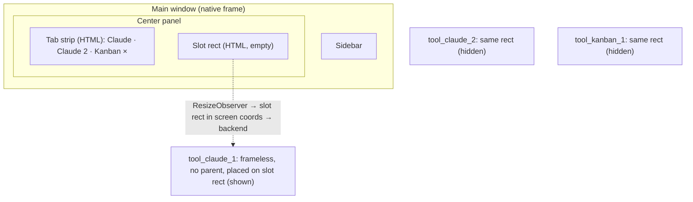

# E03 — Docked view, tabs and quick links

Owner, 2026-10-16:

> gostaria de ter a visualização central, painel que não é o lateral, sendo a visualização da aba
> aberta como opcao, e podendo desacoplar do resto do bond a aba aberta, alem de poder abrir mais de
> uma aba para navegar entre eles (digamos, ver uma tabela em um projeto ou dois chats da claude)

Status: the requirements were approved on 2026-10-19 (RF-49…RF-52, RF-66…RF-68 enter
`docs/canonico.md` §14, §22 "E03 requirements approved (0.6.0)"), and the epic was built in **0.6.0**
the same day. Evidence by `execução`, macOS only: the spikes S0–S4 (`docs/handovers/e03-spikes.md`)
and the real-surface smoke `bun test/smoke/tabs.ts` on an unlocked screen with OmniWM active, the
smoke floating its own windows — 6 of 8 runs passed all 17 steps (`docs/handovers/e03-smoke.md` §3).
Windows and Linux were not run: there the default stays Windows, which departs from the owner's
"padrão é docked view" until the owner reads §22 "Docked mode per OS" (`Proposto`). On a tiling
window manager the Nod's windows must be floated by a WM rule, or docked tabs are re-tiled (B05). The
`mode: navigate` question of §7 q3 stays `Proposto` in `docs/canonico.md` §22 ("Views in docked mode").

## 1. What the owner gets

- **Docked mode, the default** (owner, 2026-10-16: "padrão é docked view"). The main window keeps the
  sidebar on the left. The center panel shows the open tab instead of Home or Settings, and a **tab
  strip** across its top lists the open tabs. The intended use: work happens in tabs, and the person
  keeps switching between them, following tasks spread across different tools and managing it all
  from one place.
- **Several tabs per tool.** ⌘T or "New tab" on a tool opens another tab of the same tool: two
  Claude chats, a project table next to a board. Each tab can point at its own address or view.
- **Detach.** Any tab can come out into its own window and later dock back, **without losing
  progress**: no reload, the page keeps its state (owner, 2026-10-16: "quero que deatachar nao perca
  o progresso").
- **Quick links.** A link clicked inside a tool opens as a tab right next to it; any link can also
  be opened by hand, and any tab saved to the sidebar in one step (§5).
- Every tool in its own window stays available as the other mode (setting: **Docked**, the default,
  or **Windows**).

## 2. The constraint

A web page can't host a third-party site:

- iframes are out, because the tools send `X-Frame-Options`/CSP and the origin stamp is frame-blind
  on Linux (`docs/canonico.md` §7, `docs/tinyjs.md` §9) — this holds for 0.6.0; RF-69 (§8) reopens a
  frame only for a tool whose address may be framed and only by the person's opt-in;
- the runtime has **one webview per window** and no native tabs (`docs/tinyjs.md` §3, §10.6).

So the center panel can't *contain* the tool. It can only look as if it does: each tab is still its
own tool window, **frameless and laid exactly over the center panel**, with the tab strip drawn by
the main page above it. This is the "anchored stages" idea of v1 coming back as an option. It was
dropped in v2 after problems observed by execution: the frame was sized wrong and the launcher
ignored `x`/`size` (`docs/canonico.md` §7). Those problems decide this epic, so it starts with
spikes.

## 3. How it would work



- **Tab = tool window** with id `tool_<entry>_<n>`. Today's single id per entry
  (`backend/tool-windows.ts`) becomes a list per entry. Cookies are shared app-wide
  (`docs/tinyjs.md` §3), so two Claude tabs share the same account.
- **Docked tab**: a frameless tool window **without `parent`**, placed with `x`/`y`/`size` at open
  (applied before the first paint).
  - `parent` would give native "stays above `main`, minimizes with it, moves with it on macOS", but
    it can only be set when the window opens (`backend/tiny.d.ts`, `TinyOpenWindowOptions.parent`).
    Detaching a child would mean reopening it and losing the page, so the Nod does those three
    things itself.
- **Switching tabs**: `hide({ app: false })` on the current tab, `show` on the next. The hidden page
  stays alive with its state (`docs/tinyjs.md` §3), so switching never reloads; this is the same
  mechanism RNF-09 relies on.
- **Following the main window** (done by the Nod on every OS):
  - resize: the main page watches the slot with `ResizeObserver` and sends its screen rect to the
    backend, which calls `setPosition`/`setSize` on the visible tab;
  - move: the runtime reports no move event (`onState` covers only fullscreen, maximize, minimize
    and focus — `backend/tiny.d.ts`), so the backend polls `getState()` of `main` while it's
    focused and moves the visible tab. Some lag during the drag is expected; S2 measures it;
  - stacking: when `main` gains focus, the backend re-shows the visible tab without activating it
    (`show({ activate: false })`), so it never ends up behind `main`;
  - minimize/hide: on `main`'s `minimized`/hidden state (`onState`), the docked tabs hide; they come
    back with it;
  - Wayland ignores `setPosition` (`canPosition: false`): there, docked mode isn't offered.
- **Detach — decided: no reload.** The tab stops following the slot, gets its frame back with
  `setChrome({ frame: true })`, and is placed a step off the panel. It's the same window with the
  same page, so drafts, scroll and in-page state survive.
- **Dock back**: `setChrome({ frame: false })` and snap to the slot; again the same window.
- Whether `setChrome` can toggle the frame of a live window on every OS is the first thing S1
  checks. If an OS can't, detaching there opens the tab in a window that was framed from the start
  (tabs opened framed and visually trimmed), never through a reload.
- **Keyboard**: shortcuts that work while a tool is focused stay global hotkeys registered only
  while a Nod window has focus, as today (`docs/canonico.md` §7). New: ⌘T new tab, ⌘W close tab,
  ⌃Tab next tab, ⌘⇧D detach.
- **Restore**: open tabs, their order, addresses and docked/detached state are remembered with the
  window list (`store.json`, no secrets) and reopened on the next unlock (`docs/canonico.md` §7,
  "Restauração").

## 4. Spikes first

| Spike | Question | Done when |
| --- | --- | --- |
| **S0 — fix B05** | Tool windows open with the main window's bounds; `setPosition`/`setSize` don't land (`docs/issues/B05-geometria-janelas-ferramenta.md`) | Two tools open at the requested rects; cause written in B05 |
| **S1 — frame toggle** | Frameless window + `x`/`y`/`size` lands on the slot? `setChrome({ frame: true/false })` on a live window, with page state kept? | Recorded per OS; draft text survives detach and dock |
| **S2 — follow** | Resize via `ResizeObserver` and move polling on every OS: visible gap or lag during drag/resize | Video or measured px/ms per OS; acceptable or not |
| **S3 — focus** | Clicking the tab strip in `main` must not drop the docked tab behind `main` (`show({ activate: false })` on focus) | Focus order holds on all three OSes |
| **S4 — popup adoption** (§5) | A `target=_blank` link from a chat tool and an OAuth popup, each adopted as a tab | The link opens next to its source tab; the OAuth flow completes and closes itself; on each OS |

If S1/S2 fail on an OS, docked mode is offered only where it passes, and the Windows mode stays the
default there.

## 5. Quick links

Owner, 2026-10-16: "quero também ter uma opção de abrir link no bond e/ou salvar link novo na barra
lateral mais rápido". The use he described: checking a reference a client sent in a chat, or a
documentation link on a card. In other words, **links that come out of a tool**, opened for a moment
next to the work, and sometimes kept.

This lifts a v1 non-goal: "Ser navegador: não há barra de endereço livre" (`docs/canonico.md` §2).
The Nod still isn't a browser — no history, no bookmarks bar, no extensions. Addresses outside the
catalog only open in tabs, and can become sidebar items in one step.

- **Links clicked inside a tool — the main path.** Today `"popups": "window"` turns every
  `window.open`/`target=_blank` into a real window, and `onWindowOpen` (`backend/main.ts`,
  `backend/tool-windows.ts` `onPopup`) only tracks it so the lock closes it. In docked mode the Nod
  **adopts that window as an ad-hoc tab** placed right after the tab it came from. The `open` event
  carries `opener` and the new window id (`TinyPopupEvent`, `backend/tiny.d.ts`); the Nod drops its
  frame and puts it on the slot.
  - Because it's the same window the site opened, `window.opener` still works, and OAuth-style
    popups (Discord, `docs/canonico.md` §8) finish and close themselves as before.
  - A popup the site meant to be small (a sign-in dialog) would then fill the panel. The runtime
    doesn't report the requested size, so S4 checks how the usual auth popups look as tabs. If they
    look wrong, the origins of known identity providers stay floating popups.
  - Plain links that navigate the same tab to another origin stay in that tab, as today
    (`onNavigate`).
- **Ad-hoc tabs are temporary.** They're marked "not saved". Closing one forgets it, and they are not
  restored after a lock unless saved.
- **Open link by hand**: from the palette (⌘L or ⌘K → "Open link…", paste or type) and from a deep
  link `nod://open?url=…`. The app already declares `urlScheme: nod` with single instance
  (`docs/tinyjs.md` §8), so another app or a script can hand a URL to the Nod. It opens as an
  ad-hoc tab after the current one.
- **Save to sidebar**: one button on any tab (⌘D):
  - **Same origin as a tool you already have** (for example a specific Claude chat or a project
    table): saved as a **personal view** of that tool, so it shows under the tool, not as a new icon.
  - **New origin**: saved as a **personal tool**. Title and icon come from the probe the assisted
    registration already uses (`docs/canonico.md` §8, RF-29); the person only confirms.
  - Connected mode: personal tools and views follow the person through the host
    (`docs/epics/E01-connected-mode.md` §6). Local mode: stored locally.
  - An admin can promote a personal tool to an org tool (and then grant it to roles).
- **Safety of ad-hoc tabs**:
  - the `api.origins` gate gives an unlisted origin no backend method (`docs/tinyjs.md` §9);
  - the login adapter never runs outside the origin a credential was saved for
    (`docs/epics/E01-connected-mode.md` §8);
  - only `http(s)` is accepted; anything else goes to the system browser, as navigation already does
    today.

## 6. Requirements (proposal)

RF-55…RF-57 were spent on shipped work (update notice, build icon, guild icon — `docs/canonico.md`
§14) after this epic was written, so its link, save and safety requirements are renumbered
RF-66…RF-68 (2026-10-18). RF-49…RF-52 are still free.

| ID | Requirement | Acceptance |
| --- | --- | --- |
| RF-49 | In docked mode, the open tab fills the center panel and follows the main window's size and position. | Resize and move `main`: the tab stays on the panel without a visible gap at rest. |
| RF-50 | A tool can have several tabs; switching tabs never reloads. | Two Claude tabs, a draft typed in one; switch away and back: the draft is still there. |
| RF-51 | A tab detaches into its own window and docks back without reloading. | Type a draft in a Claude tab, detach, move it to another screen, dock it back: the draft is still there and the page never reloaded. |
| RF-52 | Docked or Windows is a setting; Windows mode behaves exactly as today. | Switching the setting changes how the next tool opens; RF-19 still passes in Windows mode. |
| RF-66 | Any `http(s)` link opens in the Nod: links clicked inside a tool open as a tab next to it; the palette and `nod://open?url=` open one by hand. | A documentation link on a Kanban card opens as a tab right after the Kanban tab; pasting a URL in "Open link" or calling `nod://open` does the same. |
| RF-67 | Any tab is saved to the sidebar in one step: a personal view when its origin is already a tool, otherwise a personal tool with probed title and icon. | Save a Claude chat URL: it appears under Claude; save a new site: it appears as a new icon with its title and icon, no typing. |
| RF-68 | An ad-hoc tab gets no backend methods and no autofill. | Calling `tiny.api.call` from an ad-hoc origin is refused; no credential is filled there. |

## 7. Open questions

1. ~~Detach~~ — decided 2026-10-16: no reload (§3).
2. ~~Default mode~~ — decided 2026-10-16: Docked.
3. Views with `mode: window` (`docs/canonico.md` §7) open as a new tab in docked mode, and views
   with `mode: navigate` navigate the tool's current tab (proposal, following the tab-centered use).

## 8. Embedded tabs (0.6.0a)

**Why.** The docked tab of §3 is still an OS window laid over the panel, and OmniWM re-tiles it like
any other window; the owner asked for the window not to be a system-level window at all — "eu gostaria
que a janela nao fosse uma janela a nivel de sistema, e sim encaixasse como uma aba de verdade dentro
do Nod" (2026-10-19). He chose "Iframe for your own tools" when told the frame only works where the
address may be framed, and then "Build it + rewrite cookies on your proxy" when told about the
`SameSite=Lax` limit. RF-69 in `docs/canonico.md` §14; the decision rows are "Embedded tabs (iframe)"
and "Embedded tab preference per machine" in §22.

The spike is `docs/handovers/e03-iframe-spike.md` (whole). It measured, in tinyjs 0.57.2 on macOS,
what the model rests on: a frameable tool renders inside an `<iframe>` of the main page; `inject` is
installed per window main frame only, so a frame gets no autofill and no script; no subframe
navigation reaches `onNavigate`; `window.open` from the frame arrives as an ordinary popup; a parked
`display:none` iframe never reloads (timers throttled). The spike decided the cookies half: with the
release page (`file://`) the frame shares the app jar and persistent cookies survive a relaunch,
**except `SameSite=Lax`** (and, by leitura, `Strict`), which are never stored nor sent from the frame;
under `bun run app:dev` (`http://127.0.0.1:5173` page) every third-party cookie is blocked.

**Model, in one paragraph.** An embedded tab is kind `embedded` (`TabState.embedded`, id
`embed_<toolId>`), has **no window**, is always docked and is never detached. The page keeps one
`<iframe>` per embedded tab in a layer inside the slot — created once, hidden with `display:none` when
another tab is active, never re-created on a re-render — so switching tabs, opening Home or Settings
and coming back never reloads it. The preference is per machine and per tool: `embedded_tools` in
`store.json` (no secret), read by `ToolsState.embedded`; `tabs.checkEmbed` asks the address
(`frameability(headers)` in `shared/tabs.ts`) and `tabs.setEmbedded` refuses with the header as the
reason when it may not be framed. The backend shows no window while an embedded tab is active.

**Limits per tool.** Measured framing (`execução`, both regimes) plus the login conclusion.

| Tool | Framing | Login inside the frame | What it takes |
| --- | --- | --- | --- |
| Jitsi (`jitsi.copland.studio`) | renders, no `X-Frame-Options`/CSP | works as far as the spike measured (landing page, no login attempt) | nothing |
| AFFiNE (`affine.copland.studio`) | renders, no `X-Frame-Options`/CSP | its session cookie is `SameSite=Lax` — leitura: `packages/backend/server/src/core/auth/service.ts` of toeverything/AFFiNE — so the release frame drops it and the tab looks logged out | the proxy rewrite below (`SameSite=Lax` → `None`, `Secure`) |
| Planka (`kanban.copland.studio`) | renders, no `X-Frame-Options`/CSP | will **not** keep a login even with the proxy: its client writes `accessToken` from JavaScript with `sameSite: 'strict'` (leitura: `client/src/utils/access-token-storage.js` of plankanban/planka), and no response-header rewrite can change a cookie the page creates itself | none known — leave it as a window |
| Claude (`claude.ai`) | **refused**, measured: `X-Frame-Options: SAMEORIGIN` (and a CSP on its challenge page) | n/a | none — stays a window, as the RF-69 acceptance says |

Dev runs (`bun run app:dev`) never keep a framed login: the page is `http://127.0.0.1:5173`, so the
frame is third-party and WebKit neither stores nor sends its cookies — only release builds (the
`file://` page) keep a login. Windows and Linux were not measured; the runtime's own notes say Linux
stamps origins frame-blind, so the `api` gate could not tell a frame from a top-level page there.

**Proxy recipe for the owner's own hosts (leitura, not executed).** This is what "rewrite cookies on
your proxy" means, for both proxies the owner's Coolify can put in front: turn every
`SameSite=Lax|Strict` in a `Set-Cookie` response header into `SameSite=None` and make sure `Secure`
is present (a `SameSite=None` cookie without `Secure` is dropped by the engine). Scope it to the
tool's host only.

Caddy, on the site block that fronts the tool:

```caddyfile
affine.example.com {
	reverse_proxy 127.0.0.1:3000 {
		# 1) Lax/Strict -> None
		header_down Set-Cookie "(?i);\s*SameSite=(Lax|Strict)" "; SameSite=None"
		# 2) append Secure when the attribute is missing (the cookie then ends in SameSite=None)
		header_down Set-Cookie "(?i)^(.*; SameSite=None)$" "$1; Secure"
	}
}
```

Traefik cannot rewrite a response header with its own middleware, so it needs a plugin (for example
`rewriteheaders`, `github.com/XenitAB/rewrite-headers`, declared under `experimental.plugins` in the
static config). Dynamic config file:

```yaml
http:
  middlewares:
    nod-cookie-rewrite:
      plugin:
        rewriteheaders:
          rewrites:
            - header: Set-Cookie
              regex: "(?i);\\s*SameSite=(Lax|Strict)"
              replacement: "; SameSite=None"
            - header: Set-Cookie
              regex: "(?i)^(.*; SameSite=None)$"
              replacement: "$1; Secure"
```

Coolify (Traefik labels on the service; the file provider must load the snippet above, and the
router name is the one Coolify generated — check it in the service's labels):

```yaml
labels:
  - "traefik.http.routers.affine-https.middlewares=nod-cookie-rewrite@file"
  - "traefik.http.routers.affine-http.middlewares=nod-cookie-rewrite@file"
```

The attribute order matters: both rules expect `SameSite` to be the cookie's last attribute (or to
end the header) before `Secure` is appended; if a tool emits `Secure` before `SameSite`, add a third
rewrite instead of relying on the second. Confirm the plugin's key and rewrite field names against
its README — this recipe is leitura.

**Tradeoff.** `SameSite=None` makes the cookie go on cross-site requests from any site, so CSRF
protection then rests on the tool's own tokens: only apply it to a host the owner controls, and never
to a host where the tool has no CSRF defense. It also widens where a leaked cookie can be replayed.
The rewrite changes headers in flight only; the Nod's own storage and the vault are untouched, and an
embedded tab still gets no autofill, no injected script and no backend method beyond its
`api.origins` entry.
