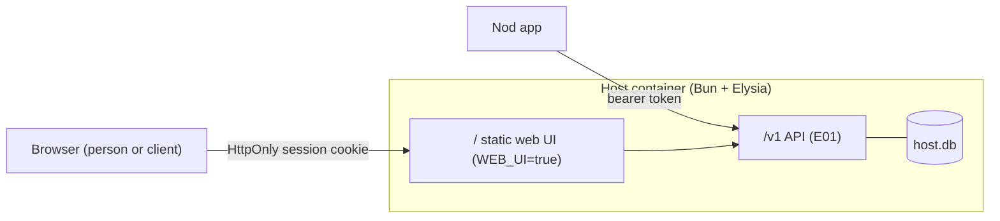

# E04 — Web Nod

Owner, 2026-10-16:

> quero pensar tb na possibilidade de hospedar junto do stack, opcionalmente, uma versao nao headless
> onde uma pessoa pode acessar o bond via acesso da sua propria maquina. isso provavelmente seria algo
> posterior mas é bom para fazer isso para clientes acessarem material nosso se precisar

Later phase, after E01's host and Nod connected mode. Proposal waiting for the owner's reading
(`AGENTS.md`). It's the "host the shell on the web" idea that `docs/canonico.md` §2 and §23 q11
deferred, now with a concrete reason: clients reaching our material without installing anything.

Evidence: `leitura` of `src/api.ts`, `src/settings.ts` and the repo docs. Nothing here was executed.

## 1. What it is

- **Optional**: the same host container serves a browser version of the Nod when an env flag turns
  it on (`WEB_UI=true`). Off, the host stays API-only, as E01 defines it.
- **Same guild, same accounts**: sign-in, roles, grants and catalog are the host's (E01 §6–§7). A
  person can use the app at work and the browser elsewhere.
- **For clients**: the admin creates them like anyone else (email → access code → password), with a
  role that grants only the material meant for them.

## 2. What the browser version can and can't do

A browser page is weaker than the app: it can't open a tool inside itself (iframes are blocked by the
tools' own headers, `docs/canonico.md` §7), can't fill a login on another site, and has no system
keychain.

| Capability | App | Web |
| --- | --- | --- |
| Sidebar, Home, palette, favorites, personal tools | yes | yes |
| Open a tool | docked tab or window | **new browser tab** (`target=_blank`) |
| Docked view, detach, ad-hoc tabs (E03) | yes | no — the browser's own tabs do that job |
| Login cascade / autofill (`docs/canonico.md` §11) | yes | **no**: a page can't touch another origin |
| Vault, reveal, sharing (E02) | yes | **no** in this epic — see §5 |
| Admin screens | yes | yes, read and write through the host API |
| Works offline | yes | no |

So for a client it's a **portal**: sign in, see the links granted to you (a shared Affine page, a
public board, a delivery folder), open them. The tools still decide who gets in: an Affine document
needs a public share link or a client account in Affine; the Nod only lists and organizes.

## 3. Shape

- **One origin**: the web UI and the API on the same address, so the browser needs no CORS and the
  cookie stays first-party.
- **Session in the browser**: `HttpOnly; Secure; SameSite=Strict` cookie holding the same kind of
  session row as the app's bearer (E01 §7), revocable per device. CSRF: SameSite plus an
  `Origin` check on every write.
- **Password stays on the machine here too**: the page derives `authKey` with WebCrypto PBKDF2 and
  sends only that (E01 §7). The derivation and the iteration count live in `shared/auth.ts`,
  so app and web compute the same key.
  - **Limit of that promise on the web**: the page's JavaScript comes from the host itself. A
    compromised host can serve a page that sends the typed password anywhere. In the app the code
    ships with the release, so the host never controls it. On the web, "the host can't see the
    password" holds only while the host is honest. This is why the vault stays out of the web
    version (§5).
- **Code reuse**: the app's page talks to its backend only through `src/api.ts` (`call`, `on`);
  `src/settings.ts` also uses `tiny.dialog` for export/import files (`leitura`). A web build swaps
  `src/api.ts` for an HTTP client of the host API and replaces the file dialogs with browser
  download/upload. Screens that only make sense in the app (vault, docked tabs) are left out of the
  web build.
- **Hardening**, because it's public: strict CSP for the web UI, rate limits already in E01, and an
  admin switch per role "may use the web" (default: on for clients, on for members).

## 4. Clients as a kind of person

Clients are outside the team, so a few E01/E02 rules change for them:

- Person gets `kind: 'member' | 'client'`.
- Clients don't receive credential shares with scope **org** (E02 §1), and can't add personal tools
  (proposal; question 2).
- Holders lists and events show clients marked as such.

## 5. Later inside this epic: vault on the web

Possible, not proposed now: the private keys (E02 §3) encrypted with `vaultKey` and kept in
IndexedDB, WebAuthn as the "biometric" gate. It would let a member reveal a shared password from the
browser. It weakens E01's promise — a compromised host can serve a page that leaks `vaultKey` the
next time someone signs in on the web — so it stays out unless the owner asks for it.

## 6. Milestones

| Milestone | Scope | Proof |
| --- | --- | --- |
| **M1 — portal** | `WEB_UI` flag; static build served by Elysia; cookie sessions; sign-in and activation in the browser; sidebar, Home, palette, favorites; tools open in new tabs | A client account sees only its role's links from a browser on another machine |
| **M2 — admin on the web** | Settings screens for admin through the host API | Create a client, grant a link, from a browser |
| **M3 — clients** | `kind: client`, per-role web access switch, sharing limits | A client can't receive an org-scope share; disabling web for their role signs them out |

## 7. Requirements (proposal)

| ID | Requirement | Acceptance |
| --- | --- | --- |
| RF-58 | With `WEB_UI=true`, the host serves a browser version on its own address; without it, no web UI exists. | Flag off: `GET /` is 404; flag on: sign-in page. |
| RF-59 | Browser sessions are HttpOnly SameSite cookies, revocable like app sessions. | Revoking the device on the host signs the browser out on its next request. |
| RF-60 | The browser never sends the password: it derives `authKey` with the same parameters as the app. | A capture of web sign-in shows no password; the same password signs in on app and web. |
| RF-61 | A client sees only what their role grants and opens tools in new browser tabs. | Client account on a clean browser: only granted links, each opening in a new tab. |

## 8. Open questions

Parked by the owner on 2026-10-16 ("acho que podemos deixar essas perguntas do e04 pronta"): they're
answered when E04 starts, after E01 and E02.

1. Same address as the API, or a separate one (e.g. a `portal` subdomain) for clients?
2. Can clients add personal tools and favorites, or only see what's granted?
3. Should a client see anything besides links — a short note per item, a welcome page per role?
