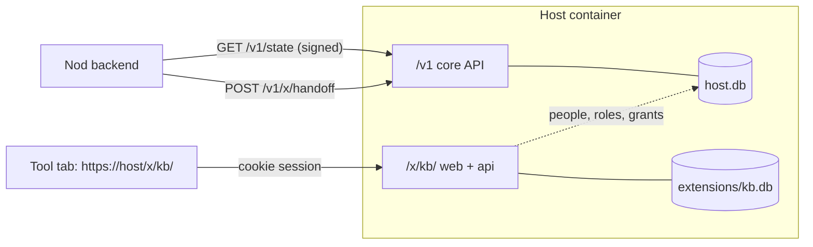

# E05 — Extensions and the team knowledge base

Owner, 2026-10-17:

> bote na pesquisa de algum dos proximos epicos adicionar um sistema de extensoes. entre essas
> extensoes, quero colocar uma base de conhecimento em tiptap com base propria e compartilhada dentro
> da equipe. a extensao será instalada só no host ou pelo cliente, mas se estiver só no host, quem
> acessar consegue ver as extensoes

Research epic, a later phase after E01's host. It's a proposal waiting for the owner's reading
(`AGENTS.md`). It reopens two v1 non-goals, so nothing here applies until the owner decides (§2).

Evidence: `leitura` of `docs/canonico.md`, `docs/tinyjs.md`, `docs/downscale-carna.md`,
`host/context.md`, `backend/tiny.d.ts`, `shared/host-api.ts`, and of Carna's docs and code (paths
under `Carna/` are relative to `/Users/caio/_Eclaire/_Workspace/Projects/_Aleph/`, as in
`docs/canonico.md` §24). Nothing here was executed.

## 1. What the owner gets

- **An extension system.** An extension is a packaged feature with an id, a version and parts that
  run on the host, in the Nod, or both. It's added to an install, not compiled into the catalog.
- **Two places to install it**:
  - **On the host.** The admin enables it once on the guild's host. Every connected Nod sees it
    at its next sync, with nothing installed on that machine. Who sees it follows roles and grants,
    like any org tool. This is the owner's "se estiver só no host, quem acessar consegue ver".
  - **In the Nod (client).** A person enables it in their own Nod. It runs on that machine with
    local data and needs no host.
- **The first extension: a knowledge base.** Pages edited with tiptap, kept in the extension's own
  database on the host, and shared with everyone in the team the admin grants it to.

## 2. What this changes in the canon

Today the canon rules extensions and editing out:

| Where | Today |
| --- | --- |
| `docs/canonico.md` §1, principle 6 | "Sem código de terceiros dentro. O Nod não tem sistema de extensões: ele cadastra endereços." |
| `docs/canonico.md` §2, out of scope | "Hospedar código de terceiros: sem extensões, plugins ou scripts baixados." and "Editar conteúdo: nenhum editor, nenhuma base de conhecimento, nenhum agente." |
| `docs/canonico.md` §22, row "Extensões" | Out of v1, `Proposto` |
| `docs/downscale-carna.md` "fica de fora" | Hocuspocus/Yjs, tiptap; knowledge base; extensions (registry, manifest, actor, WASM/Extism, third-party iframes) |

Proposal: lift "no extension system" and "no knowledge base", and **keep "no third-party code"**.
Extensions are **first-party**: they live in this repository and ship in the host image or the Nod
release, reviewed like any other code. Why: tinyjs can't isolate local code from the app's backend,
and a host extension's server code runs inside the host process with access to its data (§5).
Third-party extensions would need a sandbox neither side has. Question 2 asks the owner to confirm.

What Carna planned and what it built (`leitura`), so this epic doesn't inherit a design that was
never tested:

- **Extensions existed only on paper.** Manifest (`id`, `version`, `engine`, `permissions`,
  `contributes`, `runtime`), extensions as actors, WASM through Extism, iframes with
  `sandbox="allow-scripts"` (`Carna/docs/Documento canônico …` lines 58–59, 741–775). No code
  (`Carna/apps/api/lib/carna/` holds `accounts`, `collab`, `system`, `trace`). The Extism decision
  was still open (line 58). How a client finds the extensions a server has is never described.
- **Collaborative editing did get built.** Hocuspocus 4.7 over `Bun.serve`
  (`Carna/apps/collab/src/server.ts`), Yjs state stored as bytes (`Carna/apps/collab/schema.sql`),
  readable JSON and text derived on store with `TiptapTransformer`
  (`Carna/apps/collab/src/snapshot.ts`), tiptap 3.31.4 with StarterKit only
  (`Carna/packages/editor/package.json`). Its authorization lets any signed-in account open any
  document (`Carna/apps/api/lib/carna_web/internal/collab_controller.ex`).
- **The knowledge-base model stayed a design**: pages, polymorphic links, tags, wikilinks as a
  tiptap `Mention` with `[[` (Carna doc lines 334–342). Its lesson is kept here: filter permissions
  inside the same query as search, or a filter bug leaks other people's text (line 362).

## 3. What an extension is

A manifest plus up to three parts. The manifest is data, and the code is first-party:

```json
{
  "id": "kb",
  "version": "1.0.0",
  "title": "Knowledge base",
  "icon": "icon.png",
  "minHost": "0.5.0",
  "minApp": "0.5.0",
  "parts": { "host": true, "web": "/x/kb/", "client": false }
}
```

| Part | Runs in | What it is |
| --- | --- | --- |
| `host` | the host process (Bun + Elysia) | An Elysia plugin mounted under `/x/<id>/api/`, with its own SQLite file and migrations. It reads people, roles and grants from the host's repo and never copies them. |
| `web` | a page served by the host, opened as a tool tab or window in the Nod | The extension's UI: static files under `/x/<id>/`. Same origin as the host API. |
| `client` | the Nod (backend module + page in the release) | For client installs: UI and logic shipped in the release, with data in its own SQLite file in the app data dir. |

Layout: `extensions/<id>/{manifest.json,host/,web/,client/}` at the repo root, `[INFERENCE]` about the
final paths. The specs settle them. The host image includes every `host` + `web` part and the
release every `client` part. **Installing means enabling**: nothing is downloaded at runtime.

## 4. Where it's installed, and who sees it

| | Host install | Client install |
| --- | --- | --- |
| Who enables | the guild's admin, on the host (question 3: env at deploy or a switch in Settings) | the person, in Settings → Extensions |
| Who sees it | everyone connected whose role has a grant for it | that person, on that machine |
| Needs on each Nod | nothing beyond a Nod that knows the `extension` entry kind (`minApp`) | the release that ships the `client` part |
| Data | the extension's database on the host, shared | the extension's database on the machine, local |
| Works offline | no: the pages live on the host | yes |
| Works in the browser (E04) | yes: it's already a host web page | no |

How a connected Nod finds a host extension. **The snapshot carries it as an org entry**:



- Enabling an extension on the host creates an org `Entry` (`shared/types.ts`) with
  `kind: 'extension'`, `extensionId`, the host's own `/x/<id>/` URL and the manifest's title and icon.
  The admin grants it to roles as with any org tool. The `Snapshot` (`shared/host-api.ts`) carries
  it inside the signed bytes.
- So the sidebar, Home, palette, favorites, grants, the stale-cache rule and revocation all work
  unchanged (`docs/canonico.md` §17). The one new thing on the Nod: opening an `extension`
  entry starts the handoff (§6).
- Disabling the extension on the host removes the entry. The data stays in its file until the admin
  deletes it on purpose.
- **Both installs of the same id**: in connected mode the host's entry is the one listed; a client
  install keeps its local data and shows under its own label ("Knowledge base — this machine").
  Nothing syncs between the two in this epic (question 8).

## 5. The runtime limits that shape this

| Fact | Source | Consequence |
| --- | --- | --- |
| The Nod's own pages (`file://*`) get the whole backend API; the backend isn't sandboxed | `docs/tinyjs.md` §2, §9 | A `client` part runs with the Nod's full power. It can only be first-party code. |
| An origin with no key in `api.origins` gets **no** backend method | `docs/tinyjs.md` §2, §9 | A host `web` page opened in the Nod can't call the Nod backend. It talks only to its host, which is what it should do. |
| No iframes for tools; the Linux origin stamp is frame-blind | `docs/canonico.md` §7, `docs/tinyjs.md` §9 | A `web` part opens as a tab or tool window (E03, `docs/canonico.md` §7), never framed inside the main page. |
| No HTTP server in the app | `docs/tinyjs.md` §10.1 | A client install can't serve a page from another origin to isolate itself. That's why §2 keeps third parties out. |
| A remote site can't be packaged offline | `docs/tinyjs.md` §10.4 | A host extension needs the network. Offline work is the client install's job. |
| One cookie profile per app | `docs/tinyjs.md` §10.3 | The extension's session cookie lives beside the tools' cookies. It's bound to the host's origin. |

## 6. Signing in to a host extension without typing

The Nod holds a bearer token in the keychain (E01 §7). A host page needs a browser session. The
bridge between the two:

1. Opening an `extension` entry makes the Nod backend call `POST /v1/x/handoff {extensionId}` with
   its bearer.
2. The host answers with a single-use code, valid for 60 s, tied to that session and that
   extension. Only its hash is stored.
3. The Nod opens `https://<host>/x/<id>/enter?code=…`. The host checks the code, sets an
   `HttpOnly; Secure; SameSite` cookie scoped to `/x/<id>/`, and redirects to the page.
4. The cookie session is a child of the device session. Revoking the device (RF-39) or the
   person's grant ends it on the next request.

The same cookie machinery serves E04's browser sessions (E04 §3, RF-59). Whichever epic lands first
builds it, and the other reuses it.

Hazard: the code travels in a URL the Nod opens, and `TINYJS_DEBUG=1` prints API calls up to 160
characters (`AGENTS.md`). The code is short-lived and single-use, so a leaked one is worth little.
`AGENTS.md`'s list gains the opening call when this is built.

## 7. The knowledge base extension (`kb`)

### What it is

A tree of pages for the team: notes, how-tos, decisions, onboarding. Edited in place with tiptap and
shared with everyone the admin grants it to. Host install first (M2). A client install (local-only
KB) comes later (M4).

### Data — its own database

`/data/extensions/kb.db`, separate from `host.db`, with its own ordered migrations. The host's
backup timer (`host/backup.ts`) copies it too. People and roles are referenced by id and read from
the host's repo, so there's no second source of truth for who exists or who may see what.

| Table | Columns (proposal) |
| --- | --- |
| `kb_page` | `id`, `parent_id`, `position`, `title`, `doc` (tiptap/ProseMirror JSON), `text` (derived plain text), `revision`, `created_by`, `updated_by`, `created_at`, `updated_at`, `deleted_at` |
| `kb_revision` | `page_id`, `revision`, `doc`, `updated_by`, `updated_at` (last N per page, N to be set) |
| `kb_page_fts` | FTS5 index over `title` + `text` |

- **Content as JSON, text derived on save.** That's Carna's pattern without Yjs (`snapshot.ts`
  derives JSON and text from the Yjs state). The host validates `doc` against the same tiptap schema
  the editor uses, and drops unknown nodes and marks before storing.
- **FTS5 in `bun:sqlite`**: `[INFERENCE]`, to be measured in M2's first story.

### Editor

- tiptap 3 (Carna pins 3.31.4): StarterKit, Link, task list, code block, headings. Wikilinks
  `[[page]]` as a `Mention` carrying the page id, the shape Carna designed (line 337).
- Images: only as external URLs in M2. The host body limit is 256 KB (`host/context.md`), and
  uploads would need storage (question 6).

### Sharing and permissions

- **M2: one shared space per guild.** Whoever's role has the grant for the `kb` entry reads and
  edits every page. The admin sees everything, as everywhere (`docs/canonico.md` §10).
- Per-role spaces or read-only roles are question 4. With either one, search filters visibility in
  the same SQL query (the Carna lesson in §2).

### Concurrent edits — no real-time in M2

`docs/canonico.md` §17 says "Nada de replicação em tempo real". M2 keeps that rule:

- Every save sends the `revision` it started from. A stale save gets `409`, and the editor keeps
  the person's text, shows the newer version, and offers to copy theirs or overwrite. Nothing is
  silently lost.
- Real-time co-editing (Yjs + Hocuspocus, which Carna already runs on Bun) is M5. It needs the
  owner to lift §17 for this extension (question 5).

### Events

Page created, edited, moved, deleted and restored become host events with the page id and the
person, **never the content** (`docs/canonico.md` §13 rule extended to content).

## 8. Security

| Threat | Defense |
| --- | --- |
| Extension code doing harm | First-party only, in this repo, reviewed like the core (§2). Third-party code stays out. |
| A host page calling the Nod backend | Its origin has no `api.origins` key, so it gets no method (`docs/tinyjs.md` §9). RF-63 proves it. |
| Compromised host serving a malicious page | Same limit as E04 §3: the page's JS comes from the host. It can't reach the Nod backend, vault or keychain, only what the host already holds. |
| Stored XSS through page content | `doc` validated against the editor's schema on the host, never raw HTML. Strict CSP on `/x/*` (`script-src 'self'`). |
| A person reading pages they lost access to | Grant checked on every request, not only at handoff; revoking the device or the grant ends the cookie session. |
| Search leaking pages | Visibility filtered inside the search query (§7). |
| Handoff code stolen | Single-use, 60 s, hash only, tied to session and extension (§6). |
| Extension tables corrupting core data | Own database file; the extension reaches core data only through the host's repo functions. |

## 9. Milestones

| Milestone | Scope | Proof |
| --- | --- | --- |
| **M1 — host extension frame** | Manifest; enable on the host; own database + migrations + backup; `extension` entry in the signed snapshot; handoff and cookie session; a placeholder page | Enabling `kb` on the host makes it appear on a connected Nod that installed nothing; a person without the grant doesn't see it; disabling removes it at next sync |
| **M2 — knowledge base on the host** | Page tree, tiptap editor, save with revision and `409`, history and restore, FTS search, events | Two machines: A writes a page, B finds it by search and edits it; a stale save from A keeps A's text |
| **M3 — KB in the Nod** | KB pages in the palette (searched through the host by the Nod backend), open a page directly as a tab | `⌘K` "onboarding" lists the KB page and opens it on that page |
| **M4 — client install** | Settings → Extensions; `client` parts shipped in the release; local database; KB local mode | A Nod with no host enables the KB, writes a page offline, and it survives a restart |
| **M5 — later: real-time co-editing** | Yjs state + Hocuspocus beside the host, JSON and text derived on store (Carna's `apps/collab`) | Two people type in the same page and see each other's cursor |

Sizing comes when the owner puts E05 in a block (`docs/epics/blocks.md` §1 method).

## 10. Requirements (proposal)

| ID | Requirement | Acceptance |
| --- | --- | --- |
| RF-62 | An extension enabled on the host appears for every connected person whose role has its grant, with nothing installed on their Nod. | Enable `kb` on the host; after "Sync now" a granted person sees it in the sidebar, an ungranted one doesn't; disabling hides it at the next sync. |
| RF-63 | Pages served by a host extension get no Nod backend method. | `tiny.api.call` from the KB page is refused. |
| RF-64 | Opening a host extension from the Nod signs in without typing, through a single-use handoff. | The code works once and dies after 60 s; revoking the device ends the extension session on its next request. |
| RF-65 | Each host extension keeps its own database file, covered by the host backup. | `host.db` has no `kb_*` table; a backup restored into a fresh host brings the pages back. |
| RF-66 | Granted people create, edit, move and delete KB pages with tiptap, shared with everyone granted. | A writes a page on machine A; B opens it on machine B and sees the same content. |
| RF-67 | A stale KB save is refused without losing the text. | A and B edit the same page; the second save gets a conflict and still shows its own text to copy or overwrite. |
| RF-68 | KB search covers titles and text and only returns pages the person may see. | A search for a word in a page returns it to a granted person; a person without the grant gets nothing. |
| RF-69 | Each KB page keeps its last revisions and can restore one. | Restore revision 2 of a page edited 3 times; the content matches revision 2 and a new revision is recorded. |
| RF-70 | A client install works without a host, with data on that machine only. | A Nod with no host enables the KB, writes a page with the network off, restarts, and the page is there. |

## 11. Proposed vocabulary

These terms wait for the owner's reading before they go into `CONTEXT.md`:

- **Extension** — `Extension`: a first-party packaged feature with a manifest and host, web or
  client parts. _Avoid_: plugin, add-on, app.
- **Host install / client install**: where an extension is enabled.
- **Knowledge base** — `kb`: the first extension. **Page** — `KbPage`: one document in it.
- **Handoff** — `handoff`: the single-use code that turns the Nod's bearer into a host page session.

## 12. Open questions

1. **"Instalada pelo cliente"**: does it mean a local install that works without a host (this
   proposal), or a Nod-side add-on that deepens a host extension (offline cache, palette)? M3 covers
   part of the second meaning anyway.
2. **First-party only?** Confirm that third-party extensions stay out (§2, §5), or name the sandbox
   to research.
3. **How the admin enables a host extension**: an env variable at deploy (`NOD_EXTENSIONS=kb`, the
   way the host is configured today, `host/config.ts`), or a switch in Settings → Extensions at
   runtime?
4. **KB permissions**: one space for everyone granted (M2), spaces per role, or read-only roles?
5. **Real-time co-editing**: is save-with-conflict enough, or is M5 wanted? M5 lifts §17's "no
   real-time" for this extension.
6. **Images and attachments** in pages: external URLs only, or uploads stored by the host (needs
   storage and a larger body limit)?
7. **Clients (E04)**: should a client read selected KB pages through the web portal? That would
   answer E04 question 3 ("a welcome page per role").
8. **Local and host KB**: should a local KB later publish its pages to the host KB, or stay
   separate for good?
